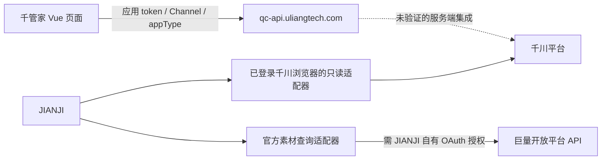

# Qianguanjia Reverse Engineering And JIANJI Integration

## Decision

本轮已验证 JIANJI 可以独立读取当前千川账户汇总；完整投放管理仍需取得官方权限并逐项实测。千管家的账号、商品、计划、素材和规则任务边界可供参考。公开前端和登录后网络均显示它调用 `qc-api.uliangtech.com` 自有中台，**没有证明其服务端如何调用千川，也没有证明所有展示功能当前可用**。因此适合借鉴流程，不适合将第三方私有接口当作 JIANJI 的长期依赖。

本轮先复用 JIANJI 已有的直接千川浏览器只读适配器，再增加官方视频素材目录查询的主进程库接缝。两者均不调用千管家。官方路线仍需要 JIANJI 自有应用/主体获得相应权限和用户 OAuth 授权；仅有千管家的登录或授权，不代表 JIANJI 可使用其服务端 token。

## Evidence Scope

日期：2026-10-13 UTC（登录后观察跨至 CST 2026-10-14），Linux / Node 22.21.0 / 正常 Chrome CDP。目标为 [千管家](https://qc.uliangtech.com/dist/dashboard/index)。首次打开跳转 `/dist/login?redirect=%2Fdashboard%2Findex`；用户随后完成正常登录。Agent 未填写密码、验证码或修改授权。登录后账户接口为空，首页明确显示示例数据。

采用 [REA](https://github.com/morluto/rea) `rea-agents@6.4.0`（MIT，官方 npm metadata 与 CLI 可用性已检查）。采用 scoped `npx`，未改全局 MCP 配置、安装新浏览器、重启或复制用户 profile。

证据等级：

| Level | Meaning |
| --- | --- |
| LIVE_OBSERVED | 本轮正常浏览器/实际网络请求直接观察 |
| STATIC_ONLY | 公开 shipped JS 中的路径、调用、字段或路由；不能证明请求成功 |
| DOC_VERIFIED | 巨量官方文档/官方 SDK 公开契约；不能证明当前账户获权 |
| FIXTURE_VERIFIED | 隔离模拟 HTTP/浏览器测试；不能证明真实平台可用 |
| NOT_EVALUATED | 登录、授权、权限或尚未执行的平台行为 |

[机器证据目录](evidence/qianguanjia-2026-10-13.json) 保存 11 个公开 JS 资源的 URL、SHA-256、401 个接口常量符号（384 个不同字面量路径）及 341 个静态调用匹配（337 个不同 method/path）。这是选定资源的提取结果，包含非千川功能、旧路径及重复项，**不是 401 个已验证接口或完整服务端 API 清单**。method 由 request helper 导出名追踪；关键业务样本另外人工核对，自动匹配清单仍需要模块/运行时复核。动态路径和未下载 chunks 不在完整覆盖声明中。

原第三方 JS 和完整 REA envelopes 仅留本地 `/tmp/jianji-qianguanjia-20261013/`，不将专有源码复制进产品。正式证据只保存功能接口事实与资源定位。

REA 静态 analysis evidence：`ev_410d497e5df26a4d2e7bd4e3509c75a054e9d117cceddc6cd1d8ab88c88837fa`，初始 main/login 两个资源；九个业务 chunks 另以静态阅读补充。REA 页面 evidence：`ev_4e67a9f941fcab0bc4432027c510b9c7ecdfeaf8ffaa099358192488d6066d45`，被动 attach，`policy_filtered`/`attach_limited`，不能恢复此前响应体。第一次 REA CDP 调用参数格式错误，未产生有效证据；纠正为默认当前 origin 后成功。

## Reproduction Procedure

公开资源 URL 和 SHA 来自机器证据目录；下载时必须核对 Content-Type 和 hash，不能把服务器返回的 HTML fallback 当作 JS。login 的本地文件名为 `login.1103.c5bf6a92.js`，真实 URL basename 为 `1103.c5bf6a92.js`。

```sh
npx --yes rea-agents@6.4.0 analyze-javascript-application /tmp/jianji-qianguanjia-20261013/assets --analysis-timeout-ms 60000 --format json
npx --yes rea-agents@6.4.0 inspect-web-page http://127.0.0.1:41845 EE3531673EEB8E0625A9115A778084C2 --include-accessibility-text --include-json-body-shapes --observation-ms 500 --format json
```

CDP endpoint/target 是本轮临时正常浏览器值，后续需重新枚举；只 attach 已授权的对应标签页，不导出 cookie/token。登录后的业务页必须重新捕获请求再比对静态目录，不能把公开资源下载视为获得业务访问能力。

## Frontend Architecture

- 公开 HTML 直接引用 `lib-vue`、`lib-router`、`lib-axios`；main bundle 包含 Vuex store、Ant Design Vue 组件及 `webpackChunkuliang`。Vue Router 使用 `mode=history`、`base=/dist/`，业务页面按 chunk 懒加载。
- Axios 的 `defaults.baseURL` 是 `https://qc-api.uliangtech.com/`。request interceptor 从应用 store 取得 `token`，加 `Channel=PC`、`appType=qianchuan`；参数去空，数组 query 用 comma 编码。只检查赋值逻辑，没有读取 token 值。
- response interceptor 处理 `code/msg/data`；登录过期类业务码跳转登录。权限与会员判断、角色路由均存在于前端；这些是正常权限边界，未绕过。
- 页面拥有账号选择、商品/抖音号选择、表单草稿、批量设置、日期/字段选择和结果展示。任务调度、平台授权 token 管理、报表聚合及平台写操作被委托给中台；其内部实现未见服务端证据。



关键定位（UTF-8 byte offset，0-based）：main `index.786d2fa8.js` SHA-256 `872ccce8d5de4d4db3283f89e67af6c312af2b4af8c5fbae040df35a330d3e35`；baseURL 1067553、token interceptor 1074250、Router history 1155589、base 1155631。各 lazy chunk 的 hash 在机器证据中。

## Interface Map

以下多数路径为 STATIC_ONLY，登录后实测在 evidence 列明确注明。method 是已追踪的调用方式；`unknown` 表示目前只看到常量，不猜测 HTTP 方法。所有相对业务路径默认落在 `qc-api.uliangtech.com`，不是千川官方 API 地址。

| Function | Method / Path | Evidence and limits |
| --- | --- | --- |
| 登录验证码 | GET `/sys/user/captcha` | 本轮浏览器请求 HTTP 200；未保存验证码内容 |
| 用户/权限入口 | GET `/sys/user/info` | main 常量 1042137、helper call 1066006；响应实际权限未核验 |
| 多账户列表 | POST `/mms/qianchuanAdvertiser/listAdvertisers` | LIVE_OBSERVED：HTTP 200/code=0/data=[]，请求体 {}；静态 main call 1022416 |
| 已授权账户 | GET `/mms/qianchuanAccount/listAuthAccounts` | LIVE_OBSERVED：HTTP 200/code=0/data=[]；尚无授权广告账户 |
| 中台 OAuth URL | POST `/auth/oAuth/getAuthUrl` | main 常量 1042530、call 1022495；实际返回授权域名未核验 |
| 授权回调/选号 | `/auth/oAuth/qianchuan/callbackV2`、`advertiserPage`、`selectAdvertiserV2` | 仅路径/调用结构；不提取授权 code/token |
| 全域商品选择 | POST `/qianchuan/uniproduct/uniRemotePage` | chunk 2126 call 99872；后端返回分页结构适配为 list/total/currentPage/totalPage |
| 抖音号选择 | GET `/qianchuan/uniaweme/listUniAwemes` | chunk 2126 call 99626；同一分页适配模块 |
| 建计划前商品检查 | POST `/qianchuan/qcunitask/checkProductCreatePlan` | chunk 2126 call 100074 |
| 预算建议 | POST `/qianchuan/uniplan/getSuggestBudget` | chunk 2126 call 100195；chunk 7888 调用入参明确见下节 |
| 全域 ROI 建议 | POST `/qianchuan/uniplan/batchGetSuggestRoi2Goal` | chunk 2126 call 100250；非真实调价验证 |
| 批量全域建计划 | POST `/qianchuan/uniplan/batchSave` | chunk 2126 call 99976；chunk 7888 submit form 159668 |
| 全域计划编辑任务 | POST `/qianchuan/uniplan/editUniPlan` | chunk 2126 call 100024；前端 startEmitPlan 提交 taskName/createMode/uniPlanList |
| 全域任务列表/详情 | GET `/qianchuan/qcunitask/searchPage`、`taskDetail` | main call 1025843 / 1026745；前端路由 `/tasklistUni/create/index` |
| 任务参数/修改 | GET `/qianchuan/qcunitask/params`、PUT `/qianchuan/qcunitask/update` | main call 1026609 / 1027660 |
| 失败任务重试 | POST `/qianchuan/qcunitask/retry/batch` | 存在固定 helper；未执行，重试是否幂等未知 |
| 全域计划详情 | POST `/qianchuan/unipromotion/getPlanDetail`、GET `/qianchuan/uniplan/getRemoteDetail/` | main call 1027008 / 1027208；尾部动态 ID 未记录为独立端点 |
| 常规 ROI 建议 | POST `/qianchuan/plan/batchRoiGoalGet` | main call 1031344；不能直接当全域 ROI 调整接口 |
| 预算/出价写入口 | unknown `/qianchuan/promotion/updateOutPlanBudget`、`updateOutPlanBid` | 目前仅常量，未校验参数、方法或成功响应 |
| 账户/计划/素材全域报表 | unknown `/qianchuan/qcunireportaccount/reportPage`、`qcunireportplan/reportPage`、`qcunireportmaterial/reportPage` | main 报表常量；不能靠名称声称当前查询成功 |
| 首页全域汇总 | POST `/qianchuan/homereport/uniHomeTop` | LIVE_OBSERVED：HTTP 200/code=0；startDate/endDate/selectFields；页面标明示例数据 |
| 本地中台素材库 | POST `/qianchuan/material/page`、`save`、`detail/report` | page 已实测 HTTP 200/code=0，分页四字段均 null；save/detail/report 仍 STATIC_ONLY |
| 平台远端素材目录 | POST `/qianchuan/qcremotematerial/searchPage` | main helper；是否缓存/增量同步未知 |
| 对象存储签名 | GET `/qianchuan/material/signature` | main call 1039127；未请求签名或下载临时凭据 |
| 旧素材上传入口 | unknown `/ad/admaterialinfo/upload?pid=` | 仅常量，未确认是否现网路径或完整上传链 |

完整公开静态目录及 wrapper 定位以 JSON 为准；报表、预算规则等其他 API 常量不逐个冒充已验证功能。

## Post-login Observation

2026-10-13 16:18:32 UTC，用户正常登录后，Agent 只通过页面菜单打开素材、账户及首页。被动 XHR 观察仅保存 host/path/method、请求字段类型、非秘密日期/指标字段和响应结构；不读取请求头、应用 token、cookie、登录响应或存储签名。页面自身产生的 `qcappdot/save` 是导航埋点，未提交广告写操作。

广告主和已授权账户接口都返回空数组；账户页面提供“账户授权/立即授权”，未点击授权。素材目录树为空；`material/page` 请求包含 searchField/orderField/order/reportMode/materialType/page/limit/pid/reportStartDate/reportEndDate，响应 `{code:0,data:{total:null,list:null,currentPage:null,totalPage:null}}`。这不等同严格的零条分页，也不证明平台素材同步成功。

首页明确提示“当前为示例数据，点此免费领取会员，畅享所有权益”。`uniHomeTop` 输入当日 startDate/endDate 与四个 selectFields（statCost、totalPayOrderGmvIncludeCouponForRoi2、totalPayOrderCountForRoi2、totalPrepayAndPayOrderRoi2）；返回 ALL/LIVE_PROM_GOODS/VIDEO_PROM_GOODS 各自 oldTotalData/nowTotalData。`dataTrend` 返回七个日期的指标结构；`advReport` 返回 total/list/currentPage/totalPage。均 HTTP 200/code=0，但属于当前示例展示，不能当作真实广告账户、平台调用或归因口径验收。

该观察推进了登录后网络与结构核验；真实计划、素材效果和 ROI/预算数据仍需要用户自行完成千管家的广告账户授权及适用套餐。是否向该第三方授权由用户决定，不影响 JIANJI 已验证的独立读取路线。

## Business Flows

### Product-wide Promotion

`/batchCreateUni/index` 懒加载 chunk 7888 等。账号组件按 `outAdvertiserId` 搜索/选择；各账号包含 awemes、products 和 deliverySetting。控成本/放量模式决定是否请求 ROI 或预算建议。

已追踪的预算建议输入（7888 byte 110053）：`marketingGoal`、`outAdvertiserId`、`awemeId`、`productIds[]`、`outPlanId`。前端从返回 `data.suggestedBudgetList` 按用户档位取值；这证明建议经过中台，不证明公式在浏览器实现。

创建任务输入（7888 byte 159668）：`params=JSON.stringify(batchCreateUni)`、`createSource`、`taskName`、`createMode`、`uniPlanList`；`TIMED_CREATION` 时加格式化 `taskStartTime`。提交后跳 `/tasklistUni/create/index`。因此可借鉴“草稿→预检/建议→任务→逐项结果”结构；没有证据证明其服务器如何排队、限流或去重，不复制猜测的任务恢复机制。

### Material Upload And Management

`/material/index` chunk 9320 使用 `YlVideoUpload`，明确传 `ossClient`、`uploadPrefix`、`parentId`、`folders`、`respMap`、`materialType`、`advertisersList`；下载侧调用 `ossClient.signatureUrl`。主 bundle 另有 signature/save/remote-material/report 接口。

这些静态事实支持“中台素材库/对象存储 + 平台素材目录/效果”分层。完整文件上传、存储供应商、STS 生命周期、去重及同步千川的服务端调用尚未验证；不能把看到 ossClient 或火山资源域名当作已验证的千川上传 API。

JIANJI 已有上传 service/store/egress/extension owner；本轮不再创建上传队列，也没有选择或上传真实素材。

### ROI And Budget Rules

ROI 页面 chunk 2126 有 `ruleParamDTO.currentMonitorRoiParam.roiLimit`、`scheduleType/scheduleTime`、`lastTimeMonitorRoiParam`，预算规则 chunk 4961 有 NOTICE 和预算/ROI 联动字段及 create/edit/delete 权限码。

这说明前端可编辑条件规则并委托后端。监控频率、数据延迟、触发去重、账户级预算上限、回滚与未知结果处理均需服务端证据，未验证。规则 UI 与实际千川预算/ROI 写能力必须区分。

### Reporting And Material Analysis

首页 `startDate/endDate/selectFields` 查询由中台聚合。全域素材/视频页面字段包括消耗、支付订单、含券 GMV、ROI；指标选择/列配置属于前端。业务报表是否实时或缓存、结算归因、含券/净成交口径与退款更新不能由字段名称推出。

JIANJI 既有只读适配器明确选择 4 个 ROI2 指标，保留原始 value 与 display，不把缺指标填零；后续分析应保存日期、时区、dataset/filter、平台原始单位和采集时间。

## Backend And Official API Dependency

可以确认的是浏览器业务调用中台、前端存在 OAuth 入口及任务/素材/报表边界。只能推测中台将授权账户接入千川；目前未看到中台到巨量开放平台的请求、API 版本、签名、token 刷新或服务器代码，不能宣称“已证实千管家使用官方 API”或“它使用平台私有接口”。

独立官方路线由公开官方契约支持：

| Goal | Official evidence | Validation state |
| --- | --- | --- |
| 素材目录 | GET `/open_api/v1.0/qianchuan/video/get/`，Access-Token/advertiser_id/page/page_size，list/page_info | 官方文档 + 官方 SDK 路径/字段核验；无真实 OAuth 调用 |
| 广告主授权 | OAuth access_token/advertiser 列表与千川账号授权类接口 | 需 JIANJI 自有应用权限及用户授权 |
| 商品全域创建 | 商品/直播全域创建文档 | 完整必填字段、当前账户资格未验证 |
| 全域预算修改 | `/uni_promotion/ad/budget/update/` | 官方文档存在；需逐广告主/计划授权与上限，未执行 |
| 素材/全域报表 | 官方 SDK 有 report/material、report/uni_promotion 配置/查询接口 | 不能仅凭 SDK 名称确认字段/权限或口径 |
| 商品全域 ROI 修改 | SDK 存在 ROI goal 更新入口 | 是否覆盖当前商品全域场景与所有模式尚未证实 |

主来源：[官方视频目录文档](https://open.oceanengine.com/labels/12/docs/1739309912219663?origin=left_nav)、[官方视频 API SDK](https://github.com/oceanengine/ad_open_sdk_java/blob/b9a89b8b4a86ac151935502ed3cd40fc050b53aa/src/main/java/com/bytedance/ads/api/QianchuanVideoGetV10Api.java)、[官方素材结果模型](https://github.com/oceanengine/ad_open_sdk_java/blob/b9a89b8b4a86ac151935502ed3cd40fc050b53aa/src/main/java/com/bytedance/ads/model/QianchuanVideoGetV10ResponseDataListInner.java)。SDK 公布的是固定 GET 路径，结果 video id 为字符串、material_id 为数值；SDK 默认 basePath 仍为 HTTP，本实现固定 HTTPS，不继承该默认。官方网页 request-address 与旧示例路径存在不一致，本实现采用与官方 SDK 一致的千川专用路径，真实授权验证仍是必要步骤。

其他来源：[官方全域预算更新](https://open.oceanengine.com/labels/12/docs/1841395352172800?origin=left_nav)、[官方全域创建](https://open.oceanengine.com/labels/12/docs/1804360384937988?origin=left_nav)、[官方状态更新](https://open.oceanengine.com/labels/12/docs/1804364027501580?origin=left_nav)、[官方商品抖音号准入](https://open.oceanengine.com/labels/12/docs/1825216033296576?origin=left_nav)。这些说明平台能力存在，不证明 JIANJI 或千管家账户已经获权。

当日时效事项：[2026-09-15 官方 MCP 变更公告](https://open.oceanengine.com/changelog/1866779017215370) 指出 2026-10-13 关闭旧授权生成 API-Key 的营销/千川 MCP 机制，改用手动 API-Key；巨量营销 MCP 写能力限制不能扩张解释为“所有千川 REST 写 API 停用”。本轮选择 REST 库接缝，不依赖旧 MCP key。

## Reproducibility Matrix

| Capability | Independent route | Current boundary |
| --- | --- | --- |
| 计划详情、ROI/预算读取 | 现有 `QianchuanBackendAdapter` 在正常千川浏览器 same-origin 读取 | 已有源码/隔离回归；本轮实机证据单列，不依赖千管家 |
| 账户消耗/成交/ROI 汇总 | 同上 fixed statQuery | 本轮正常账户独立实测成功，LIVE_OBSERVED；日期≤31天、CST、4指标 |
| 单计划视频素材效果 | 同上 fixed material/list-required | 固定类型/状态过滤，不等同全库素材列表 |
| 视频素材目录 | 新 `QianchuanOpenApiVideos` | 官方契约+模拟 HTTP；真实账户未授权，NOT_EVALUATED |
| 视频上传 | 复用既有 JIANJI upload owner；或获得官方上传权限后适配 | 本轮没有真实上传/转码/归属回执 |
| 多店铺/多广告主 | 复用现有账号配置、账号选择与 egress owner；官方令牌须逐账号授权 | 千管家的多账户页面静态存在，实际账户授权未验证 |
| 创建/停启计划、预算/ROI 写入 | 优先官方 API，必要时正常浏览器自动化 | 必须明确操作授权、预算上限、审计/幂等/未知结果停止；本轮无写实现、无真实变更 |
| 千管家私有任务/会员/后台规则 | 依赖其正常账号/套餐及服务端 | 已正常登录，尚无授权账户；只能核验空目录/示例查询，不能复制其后台逻辑或绕过付费限制 |

## Live Read-only Reproduction

2026-10-13 15:26:11 UTC，直接加载当前 JIANJI `QianchuanBackendAdapter`，attach 已授权正常千川浏览器当前 `/uni-prom` 标签页；没有导航、切账号、导出 cookie/token 或调用千管家。adapter guard 验证页面与可见账号 ID 一致，然后执行固定 POST `/ad/api/data/v1/common/statQuery`，查询 CST 当日 00:00:00 到 23:26:11。

实际返回通过 HTTP 200 / JSON / `status_code=0` 和四个指标单元的严格校验：消耗、支付订单数、含券成交额、ROI。输出 ID 保持字符串、raw value/display 均存在；缺指标不能变成零。正式证据只记录成功状态、字段集合、时间与源码 SHA，不提交真实账户的财务值或凭据。

这证明**当前账户的汇总查询可以脱离千管家独立复现**，不能外推到其他账户、官方 OAuth、计划/素材查询、VPS 查询、上传或投放变更。plan/materials 配方本轮未做真实回放。

## Minimal Implementation

新增主进程库 `src/main/qianchuan-open-api-videos.ts`；其单页 `list` 只调用固定官方 HTTPS GET 接口，通过同步主进程授权回调取得调用方已获授权的 token/scope。未新增凭据管理、renderer token 输入、任意 URL 代理或写操作。页面与现有三类浏览器只读查询维持原 owner。

返回 `{advertiserId,page,pageSize,total,videos:[{videoId,filename,signature,durationSeconds}]}`。不返回下载/预览 URL（官方权限与短期有效期另受限制），不投影数值 material_id，避免 JavaScript 64 位 ID 精度丢失。素材效果关联继续使用既有浏览器素材 ID；未来官方报表 join 应先解决精确 material_id 解析，不以 rounded number 关联。

该库是可运行、可测试的独立适配层接缝，**没有在 renderer 新增官方 OAuth 按钮，也没有宣称已完成官方账号接入**。在获得自有授权前，用户可使用原有千川只读面板；不能使用千管家的 token 替代。

## Extension Sequence

1. 在 JIANJI 自有应用完成最小官方素材读取 scope 授权，验证一页真实目录和账号归属，再接到现有账户 owner。浏览器路线继续作为明确标注的 session-dependent 只读 provider。
2. 用 videoId/精确 materialId/MD5 连接已有制作 output、上传回执和报表；保留每次采集的账户、过滤、归因口径与日期快照。先使用本地追加快照与增量游标，不先搭通用数据中台。
3. 在真实数据验证后增加计划目录、全域报表与素材排名；实现权限/速率/分页边界和账户隔离。官方和浏览器 response parser 分开，不混用 private 与 official schema。
4. 写操作单独启用：冻结广告主/计划/商品、before/after ROI/预算、单次/每日预算上限、有效授权、操作记录；读取确认结果，不盲重试 unknown outcome。先 dry-run，再逐次明确授权，不启用无人值守花费。
5. 只有持续多店铺采集量和分析口径确实需要时，再引入仓库/任务调度。复用现有任务、日志和账号生命周期，不复制千管家的后端或另建第二套队列。

## Authorization And Remaining Work

千管家已由用户正常登录；要核验真实计划、报表与素材效果，仍需用户自行完成广告账户授权及适用套餐。当前空授权列表及首页示例数据不能替代真实账户证据。官方接入需 JIANJI 自有巨量应用授权，千管家应用的服务端 token 不在允许提取范围。本轮真实广告花费、上传、ROI/预算调整均未执行。

项目存在其他线程的 extension/VPS/automation 工作；本轮仅提交独立 owned files，已有功能与并发改动保留。仓库未发现专用 session-record/capture skill；本报告和实现计划记录本轮 durable evidence，不写用户 memory。

## Verification Evidence

本轮 `npm run typecheck` exit 0；`tests/qianchuan-backend-adapter.test.ts` 21/21 PASS（包含既有浏览器配方与新增 7 组官方查询边界，真实 Chrome 仅为隔离 fixture）。另有临时目录 7 组 Node 模拟 HTTP 检查通过。当前新模块源码 SHA-256 为 `ebcadcf8cc0b3a55ff85b59c231e9c1a89f3bc62e141b1a56011b6832f53a8cc`，相关测试 SHA-256 为 `4127db549c6f155673c57c655886004c12430fa8d37b93766640600622372116`。

AOCI：新主进程模块为 indexed；测试、报告和证据为 observe。官方完整批次同时包含另一线程自有 backend-queries 对象；采用该 owner 提供并经父级源码核对的完整 Entry，一次 CAS 原子提交两对象，未改其业务源码。批次 applied=2、remaining=0、findings=0；正式 Verify 为 governance_aligned=true。项目 root/meta 认知刷新不包含 code 全卷，未声称完整源码认知。

owned-scope 声明保存于忽略的 `.agent/harness/runs/20261013-qianguanjia-independent/scope.json`，后续 Harness/verify 原始回执只用于对应源码字节的工程验证，不能替代登录、官方权限或真实投放验收。

首次完整 scoped 回归保留为 FAIL（本地 run `20261013T154052Z-3511e4ea`）：800 个千川用例通过，3 个已有上传场景超时；执行中共享验证器及 policy 被另一授权任务修改，导致 source identity drift 与 AOCI control 路由拒绝。相关 5 个参数用例独立诊断均通过，但这不能替代完整 required 检查。最终交付以当前稳定候选的新回执为准，旧失败不被重标。
